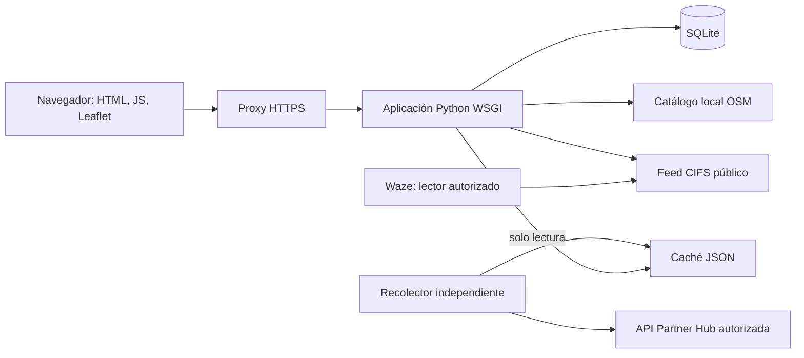

# Arquitectura y API

## Flujo principal

El backend usa la biblioteca estándar de Python y Gunicorn como servidor de producción. La interfaz usa JavaScript sin compilación y una copia de Leaflet incluida en `static/vendor/leaflet/`. El navegador solicita las teselas de mapa al proveedor configurado.

SQLite almacena el estado operativo, cuentas, sesiones e historiales. Las escrituras se realizan en transacciones; la capa operativa valida revisiones y solicitudes repetidas para evitar publicaciones duplicadas. Las sesiones se vinculan a las credenciales para invalidarlas cuando cambia el acceso.

`operations.py`, `direct.py` y `agenda.py` concentran las reglas funcionales. `app.py` aplica autenticación, autorización, validación HTTP y persistencia. `core.py` genera el feed con eventos futuros, activos y finalizados hace menos de 48 horas; ver [la guía del feed CIFS](FEED_CIFS.md). `catalog.py` carga el catálogo y `tools/build_catalog.py` permite regenerarlo explícitamente.

El recolector es un proceso separado con acceso de red. Valida la URL esperada, rechaza redirecciones y escribe una caché atómica. La aplicación lee esa caché sin necesitar acceso de red al proveedor. Los estados y notas municipales se guardan en SQLite, sin modificar la alerta en Waze.

## Superficie HTTP

Todos los ejemplos usan el prefijo `/waze`. Las rutas públicas no requieren sesión; las demás aplican autenticación y permisos.

| Método y ruta | Uso |
| --- | --- |
| `GET /waze/`, `/waze/login`, `/waze/legacy` | Páginas públicas; acciones operativas protegidas |
| `GET /waze/healthz` | Salud del servicio |
| `GET /waze/feed.json` | Feed CIFS público con cierres programados, activos y recientemente finalizados |
| `GET /waze/roads.json`, `/waze/sector.geojson` | Geometrías públicas |
| `POST /waze/api/login` | Autenticar con usuario y contraseña |
| `POST /waze/api/logout` | Invalidar sesión |
| `GET /waze/api/state` | Estado operativo y token CSRF de la sesión |
| `POST /waze/api/state` | Cambios operativos sujetos a rol, revisión y acción |
| `GET /waze/api/catalog` | Catálogo y configuración de ciudad |
| `GET /waze/api/requests/{id}` | Resultado de una solicitud de la propia cuenta |
| `GET /waze/api/agenda/{id}` | Vista previa de agenda de plantilla |
| `GET, POST /waze/api/users` | Gestión de usuarios para administración |
| `GET, POST /waze/api/monitor` | Consulta y seguimiento municipal de alertas |
| `GET /waze/api/monitor/{id}` | Historial de una alerta |

Las mutaciones autenticadas requieren cookie de sesión y `X-CSRF-Token`, además de las verificaciones de origen. La gestión de cuentas pide confirmar la contraseña del administrador. Las pruebas y el cliente son la referencia de los cuerpos JSON; no se ofrece aún un contrato OpenAPI versionado.

## Roles

- **Administración:** operación y administración de cuentas.
- **Operación:** gestión de cierres y seguimiento de alertas, según las reglas de cada acción.
- **Consulta:** lectura; sin cambios ni publicación de cierres.

## Adaptación a otro municipio

Revisar `config/city.json`, catálogo, geometrías, zona horaria y atribuciones. No basta con cambiar el título: es necesario validar sentidos, tramos, área operativa y correspondencia con Waze. La arquitectura actual es de una instancia por configuración municipal.
