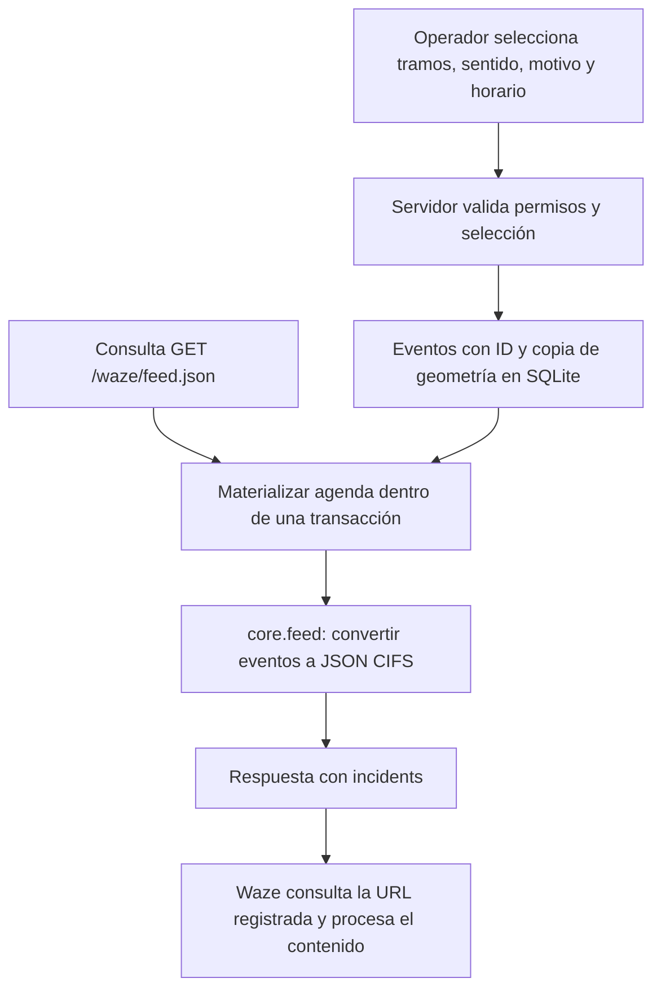

# Cómo se arma el feed de cierres para Waze

Guía funcional y técnica de `davidjrosso/wazefeed`. Código y fuentes oficiales revisados el **16 de octubre de 2026**. Los ejemplos son locales; no representan un cierre real autorizado.

## 1. Qué entrega el sistema

El panel convierte las decisiones del operador en eventos persistentes. Cuando se consulta `GET /waze/feed.json`, la aplicación lee ese estado y construye una respuesta JSON con una lista `incidents`. No se mantiene un archivo `feed.json` en disco: es una ruta dinámica del backend.

La dirección configurada para la instalación original es [https://davidrosso.ar/waze/feed.json](https://davidrosso.ar/waze/feed.json). Esta guía identifica la ruta; no certifica su disponibilidad actual ni su aprobación por Waze. El código alojado en GitHub tampoco ejecuta el servicio ni sirve ese feed.

CIFS es la especificación de Waze para intercambiar cierres e incidentes. El servicio implementa una salida JSON de cierres `ROAD_CLOSED`. La referencia normativa es la [especificación CIFS oficial](https://developers.google.com/waze/data-feed/cifs-specification).



## 2. Los dos feeds del proyecto

| Flujo | Dirección | Implementación | Finalidad |
| --- | --- | --- | --- |
| Feed de cierres / Partner feed | Sistema municipal → Waze | `core.feed()` y `/waze/feed.json` | Informar los cierres gestionados por el panel |
| Waze Data Feed | Waze → sistema municipal | `collect_waze.py` y `monitoring.py` | Consultar alertas y darles seguimiento local |

La URL del segundo flujo es privada y no está incluida en el repositorio. Sus datos no se copian automáticamente al feed de cierres. Las páginas oficiales para distinguirlos son [Partner feed](https://support.google.com/waze/partners/answer/10618039?hl=en) y [Waze Data Feed](https://support.google.com/waze/partners/answer/10618035?hl=en).

## 3. Del mapa al evento

### Selección y geometría

En [direct.py](../direct.py), `selected_segments()` recibe identificadores del catálogo y comprueba su versión. El servidor recupera los puntos desde su propio catálogo: no toma como autoridad una geometría enviada por el navegador. Valida cantidad, duplicados, área operativa, advertencias y sentido de circulación.

La selección `AB` conserva el orden de los puntos; `BA` lo invierte y cambia los extremos; `BOTH` se convierte en `BOTH_DIRECTIONS`. Una calle de sentido único solo admite `AB` en este flujo. El catálogo está en [config/roads.json](../config/roads.json). El registro inicial del modo anterior se carga desde [config/segments.json](../config/segments.json).

### Creación persistente

En [operations.py](../operations.py), `add_run()` crea una ejecución y un evento por tramo. Cada evento conserva:

- `feedId`: identificador de intercambio, generado una vez.
- `snapshot`: copia de calle, puntos y sentido al publicar.
- `start`, `end`, `created`, `updated`: instantes del evento.
- `description`, `subtype`, `runId` y `segmentId`: motivo y referencias internas.

El flujo de operativos usa IDs `municipal-<UUID>`. El flujo anterior de `core.change()` usa `rio3-<UUID>-<segmento>`. La lectura del feed no genera un UUID nuevo para un evento existente. La copia de geometría permite conservar lo publicado aunque posteriormente cambie el catálogo.

Los IDs del incidente, del catálogo y de un segmento Waze son conceptos diferentes. `wazeSegmentId` puede existir como referencia interna, pero **no se envía como campo del JSON generado por `feed()`**. La salida aporta calle, sentido y geometría para su procesamiento por Waze.

### Agenda

En [app.py](../app.py), `scheduled_state()` abre una transacción de escritura, lee el estado, ejecuta `operations.materialize()` y `agenda.materialize_map()`, y persiste los eventos nuevos antes de devolver el resultado. El feed y la consulta de estado usan esta materialización; no hace falta mantener abierto el navegador.

La agenda del mapa considera fechas desde el día anterior hasta siete días posteriores y omite intervalos ya terminados. Las claves de ejecución evitan repetir una fecha ya materializada. Se generan eventos fechados individuales: el serializador actual **no emite el campo CIFS `schedule`**. Ver [agenda.py](../agenda.py).

## 4. Cómo se serializa cada campo

La función central es [`feed(state, now=None)` en core.py](../core.py). La siguiente tabla describe el código de este repositorio; no pretende reemplazar la tabla normativa de Waze.

| Campo JSON | Origen en el código |
| --- | --- |
| `id` | `event['feedId']` |
| `type` | Constante `ROAD_CLOSED` |
| `subtype` | `event['subtype']`; si no existe, `ROAD_CLOSED_HAZARD` |
| `street` | `event['snapshot']['street']` |
| `direction` | `event['snapshot']['direction']` |
| `polyline` | Todos los puntos del snapshot, formateados a siete decimales, unidos con espacios |
| `description` | `event['description']` |
| `starttime` | `iso(event['start'])` |
| `endtime` | `iso(event['end'])` |
| `creationtime` | `iso(event['created'])`; usa `start` si no existe `created` |
| `updatetime` | `iso(event['updated'])` |

El contenedor raíz es `{"incidents": [...]}` y cada elemento es el objeto del cierre, sin un nivel adicional `incident`. Esta estructura coincide con la sección **JSON feed file** de los [ejemplos oficiales de cierres](https://developers.google.com/waze/data-feed/road-closure-information).

### Coordenadas y horarios

`polyline` usa `latitud longitud latitud longitud ...`, en grados decimales. La función GeoJSON del proyecto utiliza el orden inverso `[longitud, latitud]`; no copiar ese arreglo directamente como una polyline CIFS.

`core.iso()` genera fechas ISO 8601 con segundos y desplazamiento fijo `-03:00`. La agenda del mapa calcula intervalos con la zona IANA de su configuración; la salida CIFS sigue usando ese desplazamiento fijo. Al adaptar el sistema a otra región, revisar ambas capas.

En `operations.REASONS`, Obras se traduce en `ROAD_CLOSED_CONSTRUCTION`; Escuelas y Evento en `ROAD_CLOSED_EVENT`; Inundación, Accidente y Otro en `ROAD_CLOSED_HAZARD`. El tipo continúa siendo `ROAD_CLOSED`: seleccionar Accidente aquí describe el motivo de un cierre, no publica un reporte independiente `ACCIDENT`.

## 5. Qué eventos aparecen y cómo se reabre

`feed()` no filtra exclusivamente por cierres activos. Recorre los eventos persistidos y omite aquellos cuyo final cumple:

```python
event['end'] <= now - 48 * 3600
```

Por lo tanto, puede incluir eventos futuros, activos y finalizados hace menos de 48 horas. Las **48 horas son una decisión de este proyecto**, no una regla oficial atribuida a Waze. La lista vacía `{"incidents": []}` significa que no hay eventos exportables en ese momento; una lista no vacía no implica que todas esas calles estén cerradas ahora.

Al reabrir un cierre en curso se actualizan `end`, `updated` y `closedAt`; el ID se conserva. Durante la retención el feed comunica ese mismo evento con horario ya finalizado. Luego desaparece de la salida, pero permanece en el estado para historial.

Al cancelar una ejecución futura, `operations.stop_run()` conserva su ID y representa el evento como terminado: `start = now - 1`, `end = now`. El horario originalmente planificado queda en el registro de ejecución. La interpretación efectiva debe verificarse durante la integración con Waze; el panel no recibe una confirmación de aplicación por cada cierre.

## 6. Ejemplo reproducible sin servidor ni publicación

Con el entorno Python de [INSTALACION.md](INSTALACION.md), ejecutar desde la raíz este código en un intérprete o archivo temporal. Solo crea objetos en memoria e imprime JSON: no escribe SQLite ni hace llamadas de red.

```python
import json
from datetime import datetime
from core import empty_state, change, feed

now = datetime.fromisoformat('2026-10-16T10:00:00-03:00').timestamp()
state = empty_state()
state = change(
    state, 'activate', state['revision'], 'ejemplo-local',
    now=now,
    segment_ids=[state['segments'][0]['id']],
    description='Cierre de ejemplo',
)
# ID fijo solo para que este ejemplo sea reproducible.
# No sustituir los IDs persistentes de una instalación real.
state['events'][0]['feedId'] = 'ejemplo-local-alsina-001'
print(json.dumps(feed(state, now=now), ensure_ascii=False, indent=2))
```

Resultado verificado con el código de esta entrega:

```json
{
  "incidents": [
    {
      "id": "ejemplo-local-alsina-001",
      "type": "ROAD_CLOSED",
      "subtype": "ROAD_CLOSED_HAZARD",
      "street": "Alsina",
      "direction": "ONE_DIRECTION",
      "polyline": "-32.1728093 -64.1173807 -32.1730714 -64.1170172 -32.1733334 -64.1166537",
      "description": "Cierre de ejemplo",
      "starttime": "2026-10-16T10:00:00-03:00",
      "endtime": "2026-10-16T11:00:00-03:00",
      "creationtime": "2026-10-16T10:00:00-03:00",
      "updatetime": "2026-10-16T10:00:00-03:00"
    }
  ]
}
```

## 7. Alojamiento e integración

En esta aplicación `/waze/feed.json` es público, devuelve `application/json` y se sirve con `Cache-Control: no-store`. Las operaciones del panel requieren sesión y permisos. No colocar el login del panel delante de esta ruta.

Waze descarga periódicamente la URL registrada; el panel no hace un POST a Waze cuando el operador publica. La guía oficial habla de consultas cada pocos minutos, sin garantizar aquí una demora exacta. El alojamiento debe ser accesible para sus lectores. Waze admite distintas opciones de autenticación del feed, pero este proyecto utiliza la ruta pública descrita. Revisar [Feed Setup](https://developers.google.com/waze/data-feed/feed-setup) antes de cambiar URL, estructura, cobertura o acceso.

Para registrar la integración, una persona autorizada ingresa a Partner Hub, abre **Toolbox → Partner feed → New feed**, selecciona tipo de datos, formato JSON y especificación CIFS, agrega la URL y envía la solicitud. La aprobación es un paso externo al repositorio. Ver [alta y revisión del Partner feed](https://support.google.com/waze/partners/answer/10618039?hl=en).

## 8. Validación y diagnóstico

Con la instancia local iniciada:

```sh
curl -i http://127.0.0.1:8766/waze/feed.json
python smoke_check.py --url http://127.0.0.1:8766/waze
```

El chequeo no crea cierres, aunque consultar el feed puede materializar una agenda previamente habilitada. Valida acceso HTTP, JSON, cabeceras y protección de rutas privadas; **no valida aceptación en Waze**.

Para revisar un caso, comprobar el ID persistente, los horarios, la calle, el sentido y la polyline contra el evento guardado. Distinguir un error HTTP de un rechazo de asociación al mapa. La [ayuda de Partner feed](https://support.google.com/waze/partners/answer/10618039?hl=en) detalla errores como `STREET_NAMES_DONT_MATCH`, `FAILED_TO_FIND_ROUTE` y `NO_SEGMENTS_MATCHING_TRAFFIC_DIRECTION`. Para nombres diferentes entre mapas, consultar [Reverse Geocoding](https://support.google.com/waze/partners/answer/11486981?hl=en).

La guía oficial de cierres pide geometría que siga la calle, recomienda separación de al menos 30 m entre extremos y limita la polyline a 20 km; Waze trabaja sobre segmentos completos. El validador manual local permite desde 5 m: pasar la validación local no prueba compatibilidad cartográfica. `ROAD_CLOSED` corresponde a cierre completo del sentido afectado; este serializador no implementa cierres parciales por carril. Ver [criterios de cierres](https://developers.google.com/waze/data-feed/road-closure-information).

Las suites [test_segments.py](../tests/test_segments.py), [test_operations.py](../tests/test_operations.py), [test_direct.py](../tests/test_direct.py) y [test_agenda.py](../tests/test_agenda.py) cubren el comportamiento local. No usar un cierre ficticio en producción para probar la integración.

## 9. Índice de documentación oficial

Enlaces relevantes para construir, registrar y revisar este feed, más la documentación del flujo de monitoreo. Consultados el 16 de octubre de 2026; las páginas del proveedor pueden cambiar.

| Recurso oficial | Para qué sirve |
| --- | --- |
| [Waze Data Feed · Overview](https://developers.google.com/waze/data-feed/overview) | Entrada a las guías del intercambio |
| [CIFS specification](https://developers.google.com/waze/data-feed/cifs-specification) | Campos, formato, tipos, subtipos y opciones |
| [Road closure information](https://developers.google.com/waze/data-feed/road-closure-information) | Geometría, sentido, horarios y ejemplos de cierres |
| [Incident information](https://developers.google.com/waze/data-feed/incident-information) | Incidentes informativos; referencia para una futura ampliación |
| [Feed Setup](https://developers.google.com/waze/data-feed/feed-setup) | Alojamiento, consulta periódica, acceso y cambios de integración |
| [Esquema CIFS XML](https://www.gstatic.com/road-incidents/cifsv2.xsd) | XSD enlazado por Feed Setup; corresponde a XML, no valida directamente nuestro JSON |
| [Keep local drivers informed with the Partner feed](https://support.google.com/waze/partners/answer/10618039?hl=en) | Alta del feed y causas de errores de asociación al mapa |
| [Fix street name discrepancies with Reverse Geocoding](https://support.google.com/waze/partners/answer/11486981?hl=en) | Revisar nombres de calles contra Waze |
| [Add road closures to the Waze Map](https://support.google.com/waze/partners/topic/13436454?hl=en) | Índice de ayuda de cierres y otras herramientas |
| [Get traffic data with the Waze Data Feed](https://support.google.com/waze/partners/answer/10618035?hl=en) | Flujo entrante de datos Waze para monitoreo |
| [Waze Data Feed specifications](https://support.google.com/waze/partners/answer/13458165?hl=en) | Estructura del feed entrante; no confundir con CIFS saliente |
| [How to give Waze attribution](https://support.google.com/waze/partners/answer/10618825?hl=en) | Atribución al utilizar datos Waze |

El XSD se incluye porque lo enlaza la guía oficial; su descarga directa no pudo verificarse en esta revisión. Los enlaces de ayuda y especificaciones anteriores fueron consultados. No se incluyen tokens, URLs privadas de Partner Hub ni credenciales.
